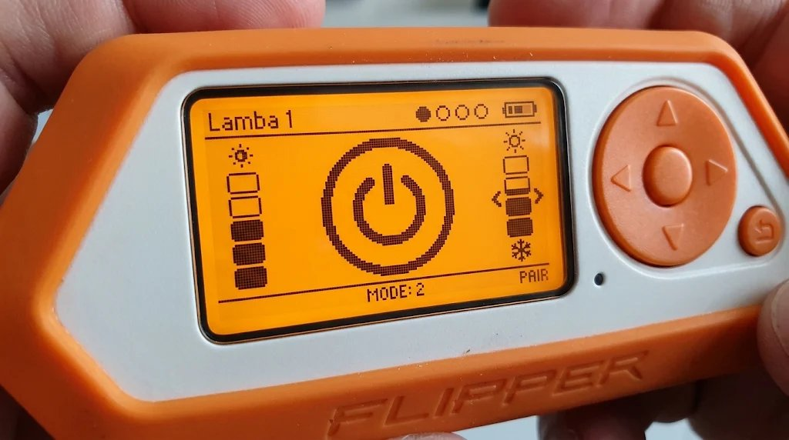

# flipper-lampsmart-pro

Connectionless BLE V3 (AES-128 ECB + XBOXES) smart lamp controller for Flipper Zero with passive remote ID cloning, multi-lamp broadcast, and custom 128x64 OLED remote UI.

[](https://flipperzero.one/)
[](https://github.com/NicoIIT/ha-ble-adv)
[](lamp_pair.c)
[](LICENSE)



---

## Overview

- **Protocol**: Implements LampSmart Pro V3 connectionless BLE advertising (`0x08F0` Service Data) with `XBOXES` whitening, `CRC16-HQX`, and `AES-128 ECB` payload signing.
- **Passive Cloning**: Uses decoded 32-bit remote IDs without triggering pairing or disrupting existing mobile app sessions.
- **Multi-Lamp Control**: Supports up to 8 lamp profiles loaded dynamically from SD card (`/ext/apps_data/lamp_pair/remotes.txt`) plus an `ALL` (`HEPSI`) broadcast mode.
- **Visual OLED UI**: 5-step vertical brightness bar, 5-step warm-to-cold Kelvin bar, central power indicator, preset modes (`Gece`, `Okuma`, `Sabah`, `Odak`), active lamp dots, and live battery icon.

---

## Controls

| Input | Action |
| :--- | :--- |
| **Up / Down** *(Short)* | Adjust brightness (`0%` – `100%`, `20%` steps) & send |
| **Left / Right** *(Short)* | Adjust Kelvin temperature (Warm ↔ Cold) & send |
| **OK** *(Short)* | Toggle Power (`ON` / `OFF`) |
| **OK** *(Long)* | Cycle preset mode (`Gece` → `Okuma` → `Sabah` → `Odak`) |
| **Left / Right** *(Long)* | Switch active lamp (`Lamba 1..4` → `HEPSI`) |
| **Down** *(Long)* | Send `PAIR` (`0x28`) command |
| **Back** *(Short)* | Exit |

---

## Core Files

| File | Purpose |
| :--- | :--- |
| `lamp_pair.c` | BLE V3 encoder, AES-128 ECB signer, 128x64 OLED UI & input loop |
| `application.fam` | Flipper Zero external app manifest (`Bluetooth` category) |
| `dist/lamp_pair.fap` | Prebuilt Flipper Zero application binary (`Target: 7, API: 87.1`) |
| `assets/preview.jpg` | Hardware OLED interface preview |

---

## Quick Start

```bash
# Build & launch directly via ufbt (Flipper connected over USB)
ufbt launch
```

Or copy `dist/lamp_pair.fap` to `SD Card/apps/Bluetooth/` via **qFlipper** / **Flipper Lab**.

Edit `/ext/apps_data/lamp_pair/remotes.txt` on the SD card (auto-created on first launch) to customize room names or add new IDs (`Name,HexID`).

---

## License

[MIT](LICENSE)
